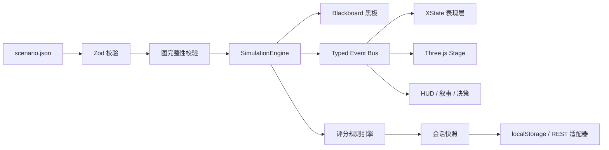

# MORAL / LAB · 伦理仿真实验室

一个在浏览器内运行的交互式伦理仿真平台。前台以「主题 → 场景变式」组织实验：主题提出问题，变式把问题变成可执行的决策。五个已接入引擎的场景共用同一套「节点图解释器 + 黑板状态 + 表现状态机 + 评分规则引擎」底座：

- **电车悖论**：道岔选择，以及天桥推人（两种变式均已接入）。
- **都江堰水利**：新增《都江堰：开山导江记》，由李冰父子与蜀郡工匠引导，从踏勘、开凿宝瓶口、竹笼筑鱼嘴、低作飞沙堰到岁修淘滩，以六次工程判断与分阶段动画还原建造过程，收尾落在「水情变了可以修，这些规矩不能丢」的岁修交接上。
- **无人驾驶**：暴雨夜、斑马线儿童与对向货车之间的避险算法选择，以及事故后的数据处置。
- **大楼倒塌**：污水渗漏、校门减速带、基坑护栏三处工程隐患的累积风险，以及联合调查中的责任链。


> 所有仿真计算（节点解释、条件分支、FSM、评分、结局判定）都在前端完成。后端只承担登录、会话持久化与汇总；本地 localStorage 仍是离线优先的事实来源，登录后会把已结束会话镜像到 `POST /api/v1/sim/sessions`。
>
> 本应用是平台主入口，统一登录页在 `/login`；全景模块作为 `/panorama/` 子路径挂载。

## 运行

```bash
cd simulation/frontend/simulation
npm install
npm run dev
npm run build
npm test
```

技术栈：Vue 3、Vue Router、Three.js、XState + @xstate/vue、zod、Pinia、TDesign Vue Next、ECharts、GSAP、Vitest。

## 路由

| 路径 | 视图 | 说明 |
| --- | --- | --- |
| `/` | `HomeView` | 深色门户首页：城市光效、动态主题卡片、平台模块与本地推演记录 |
| `/experiments` | `ExperimentCenterView` | 全部实验主题，支持类别筛选与关键词搜索 |
| `/experiments/:themeId` | `ThemeDetailView` | 主题详情、场景变式、伦理透镜与相关主题 |
| `/labs` | `PortalSectionView` | 智能实验室：实验编排与能力边界 |
| `/resources` | `PortalSectionView` | 学习资源：理论、清单、模板与术语 |
| `/cases` | `PortalSectionView` | 案例分析入口，复用主题卡片 |
| `/assessment` | `PortalSectionView` | 本地推演记录、评估说明与反馈表单 |
| `/contact` | `PortalSectionView` | 教学合作、问题反馈与联系表单 |
| `/login` | `LoginView` | 登录/注册演示页（账号服务未接入） |
| `/scenario/:id` | `ScenarioView` | 3D 实验运行页、决策、HUD、图谱、日志 |
| `/result/:sessionId` | `ResultView` | 单次会话报告、雷达图、规则审计、导出 |

场景 id：`autonomous-driving`、`trolley-problem`、`trolley-footbridge`、`building-collapse`、`dujiangyan-build`。

门户页面通过路由 `meta.portal` 使用深色外壳；`/scenario/:id` 仍为沉浸式运行页，`/result/:sessionId` 保持原有浅色报告样式。

## 都江堰：开山导江记（`dujiangyan-build`）

入口：`/experiments/dujiangyan` → “建造过程仿真”（主题页中的可运行变式），或直接访问 `/scenario/dujiangyan-build`。

- **角色引导**：旁白、李冰、李二郎、老匠、乡民轮流讲述；李冰父子在关键工序前给出判断提示，工匠与乡民承担施工与生活视角。
- **建造动画**：岷江在玉垒山前拐出弯道；都江堰尚未建成时只有一条天然河道，鱼嘴筑成后才分出内江、外江。玉垒山火烧水激开凿宝瓶口，凿通后内江水分成左、中、右三条干渠穿过成都平原；随后竹笼卵石逐笼沉江筑鱼嘴、低作飞沙堰溢流排沙、杩槎截流与凤栖窝深淘滩。每段动画由节点上的 `stage` effect 驱动，可在 `three/scenes/dujiangyan.ts` 中单独调整。
- **交互**：六次决策（治水方略、开凿工艺、堤坝材料、四六分水、堰顶高度、岁修制度）；三处可点击的踏勘点；枯水/丰水与堰顶高度会即时改变水面、分流标签与溢流状态。
- **评分指标**：治水判断、实地踏勘、施工担当、工程配合、岁修传承；结局按得分分为“主体工程配合得当”“工程已成，仍有处置需修正”“先补救挡水与维护上的疏漏”。
- **史料依据**：《史记·河渠书》《华阳国志·蜀志》、都江堰治水六字诀与《治水三字经》：“火烧水激”为传统工艺记载，具体尺寸与比例随水文年份变化；人物对白为教学化演绎。

## 目录与分层

```
src/
├─ apis/
│  ├─ experiment.api.ts        # 主题目录接口（失败时回退本地 catalog）
│  └─ session.api.ts           # 会话 REST 同步（VITE_API_BASE_URL，可选）
├─ components/
│  ├─ common/                  # AppHeader / AppFooter / PortalHeader / PortalFooter / Icon
│  ├─ home/                    # 城市背景、主题封面、主题卡片
│  ├─ portal/                  # 门户侧边工具栏
│  └─ scenario/                # HUD、决策、叙事、图谱、日志、结果叠层
├─ data/
│  ├─ scenarios/*.json         # 可执行场景包（节点、选项、条件、规则、结局）
│  ├─ scenario.schema.ts       # zod v4 严格校验
│  ├─ validation.ts            # 节点图语义校验（悬挂边、不可达、未知指标…）
│  ├─ experimentThemes.ts      # 门户「主题 → 变式」目录
│  ├─ portalSections.ts        # 智能实验室 / 资源 / 评估等模块文案
│  └─ index.ts                 # 场景注册表 + 展示元数据
├─ directives/reveal.ts        # 滚动进场指令
├─ engine/
│  ├─ SimulationEngine.ts      # 节点图解释器 + 黑板 + 事件总线（可无头运行）
│  ├─ scenarioMachine.ts       # XState 表现层：并行 / 嵌套 / 延迟迁移
│  ├─ conditions.ts            # 共享条件语言解释器
│  ├─ scoring.ts               # 规则求值、权重总分、结局选择
│  ├─ eventBus.ts / events.ts  # 类型化事件
│  └─ *.test.ts                # 无 DOM 的解释器与 FSM 测试
├─ models/
│  ├─ common.model.ts          # Primitive / Tone
│  ├─ scenario.model.ts        # 场景 DSL 静态定义
│  ├─ simulation.model.ts      # 黑板书、日志、评分结果
│  ├─ session.model.ts         # SessionRecord 持久化契约
│  ├─ experiment.model.ts      # 主题 / 变式 / 封面契约
│  └─ presentation.model.ts    # 主题色、卡片元数据、舞台热点
├─ router/router.ts
├─ services/session.service.ts # 离线优先的会话存储（localStorage）
├─ stores/preferences.store.ts
├─ stores/experiments.store.ts # 门户主题目录的加载与筛选状态
├─ styles/global.css
├─ styles/portal.css           # 深色门户设计令牌与共享组件样式
├─ three/
│  ├─ stage.ts                 # 渲染器、机位、氛围预设、CSS2D 热点、清理
│  ├─ primitives.ts            # 程序化建筑 / 车辆 / 人物 / 轨道 / 雨 / 护栏…
│  └─ scenes/                  # 五个场景的实体、动画、机位与交互（含 dujiangyan.ts 建造动画）
├─ utils/format.ts             # 时长与时间格式化
└─ views/
   ├─ home/HomeView.vue
   ├─ experiments/              # ExperimentCenterView / ThemeDetailView
   ├─ portal/                   # PortalSectionView / LoginView
   ├─ scenario/ScenarioView.vue
   └─ result/ResultView.vue
```

目录约定与主平台前端保持一致：

- 跨目录引用统一使用 `@/` 别名（见 `vite.config.ts` 与 `tsconfig.app.json`），同目录内保留相对路径。
- `*.model.ts` 只放类型与契约；`*.api.ts` 只放 HTTP；`*.service.ts` 承载无 UI 的状态或持久化；`*.store.ts` 是 Pinia store。
- `data/` 负责「加载 + 校验 + 注册」场景包，`engine/` 负责无 DOM 的推演与评分，`three/` 只负责表现。

## 门户主题目录

首页与实验中心不直接读取场景 JSON，而是读取 `ExperimentTheme[]`。一个主题包含多个场景变式，接入了引擎的变式通过 `scenarioId` 跳转到 `/scenario/:id`：

```ts
{
  id: 'trolley',
  title: '电车悖论',
  category: '道德哲学',
  artwork: 'trolley',
  accent: '#38bdf8',
  variants: [
    { id: 'switch', title: '扳道岔', status: 'ready', scenarioId: 'trolley-problem' },
    { id: 'footbridge', title: '桥上推人', status: 'ready', scenarioId: 'trolley-footbridge' }
  ]
}
```

`apis/experiment.api.ts` 会优先请求 `GET {VITE_API_BASE_URL}/experiments`（支持数组或 `{ items }`），失败时回退到 `data/experimentThemes.ts`。后端按同一结构下发即可替换本地目录，无需修改视图。

## 场景 DSL

`scenario.json` 通过 zod 严格校验，再经过图完整性校验。核心节点类型：

- `narrative`：叙事文本，继续到 `next`
- `decision`：选项、可选的倒计时与超时默认项
- `consequence`：后果节点，进入时应用效果
- `branch`：条件分支，最后一项必须是默认分支
- `end`：触发评分与结局结算

效果（effect）是声明式的：

```json
{ "type": "metric", "key": "trust", "delta": 8, "reason": "数据可被独立复核" }
{ "type": "flag", "key": "disclosure", "value": "full" }
{ "type": "stage", "action": "reveal-edr", "label": "EDR 数据公开" }
{ "type": "log", "text": "……", "title": "……" }
```

条件语言同时用于分支与评分规则，支持 `all / any / not`、决策、flag、指标、访问节点、用时与现场勘查：

```json
{
  "kind": "all",
  "conditions": [
    { "kind": "decision", "nodeId": "a_event", "optionId": "a_act_right" },
    { "kind": "flag", "key": "disclosure", "op": "in", "value": ["full", "third"] }
  ]
}
```

评分规则先对「进入规则前的指标」求值，再批量应用效果，按五维权重计算总分，最后按顺序匹配结局。规则顺序不影响指标计算，便于复盘与测试。

## 运行链路



- 决策超时由界面驱动，调用 `choose(optionId, { timedOut: true })`，并在会话中记录。
- 现场勘查热点通过 Three.js CSS2D 标签完成；`inspect` 会写入 flag 与 log，评分规则可以用 `inspected` 条件读取。
- 暂停会冻结舞台动画、倒计时与计时器；打开图谱或日志会自动暂停决策倒计时。

## 持久化与后端接口

默认写入 `localStorage`，并按登录用户隔离：

- `moral-lab.sessions.v1:<userId>`：该用户最近 60 条会话快照
- `moral-lab.preferences.v1`：动效与最近场景偏好
- `user`：与全景模块共享的登录态（`isLogin / userInfo / accessToken / refreshToken`）

登录后 `sessionService.save()` 会通过 `apis/session.api.ts` 额外向 `POST /api/v1/sim/sessions` 发送完整的 `SessionRecord`，失败时静默保留本地快照。结果页只读本地快照，不做远程兜底。

后端能力：

```http
POST /api/v1/sim/sessions              # 幂等保存会话（按 session.id）
GET  /api/v1/sim/sessions/:id          # 本人 / 教师班级 / 管理员
GET  /api/v1/sim/sessions              # 分页列表
GET  /api/v1/sim/analytics/overview    # 平台后台汇总
GET  /api/v1/sim/analytics/export.csv  # CSV 导出
```

`SessionRecord` 的结构见 `src/models/session.model.ts`，包含路径、迁移、决策、日志、指标、规则命中、勘查记录与结局。

## 测试

主入口登录与平台后台的联调说明见仓库根目录 `README.md`。`npm test` 运行 Vitest：

- 五份场景配置均通过 zod 与节点图校验
- 主题目录中每个可运行变式都能解析到已注册场景，卡片文案字段非空
- 未知指标、悬挂边、错误决策引用会被拒绝
- 代表性路径的行为与结局（自动驾驶 / 道岔 / 天桥推人 / 大楼坍塌与稳定分支）
- 勘查 flag、条件分支迁移、规则命中
- XState 并行区域、嵌套 flow、暂停与完成

> 本实验为教学研究仿真，不构成真实伦理、法律或工程安全建议。
